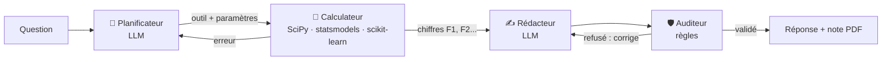

# 🔎 ProofAgent

**Un analyste IA qui doit prouver ce qu'il affirme.**

On pose une question en français sur les accidents de la route en France (2019-2024), par exemple
*« Les accidents sont-ils plus graves hors agglomération ? »*. Plusieurs agents IA y répondent, avec une règle stricte :
**le LLM n'a pas le droit d'écrire un seul chiffre**. Tous les chiffres viennent de vrais tests statistiques,
et un **auditeur** bloque les réponses trompeuses.

> Projet personnel réalisé pour pratiquer l'IA agentique sur des données publiques réelles.
> Le « client » est un assureur fictif.

---

## Le problème

Quand on demande à un LLM d'analyser des données, il peut :
- **inventer des chiffres** qui ont l'air crédibles ;
- présenter une **corrélation comme une cause** (« la pluie provoque des accidents graves ») ;
- tirer une conclusion d'un **écart non significatif** (10 personnes dans un département…) ;
- oublier qu'un nombre d'accidents ne dit **rien du risque** sans savoir combien de personnes roulent.

Pour un assureur, une seule erreur de ce type peut conduire à une mauvaise décision de tarification.

## L'idée

Séparer clairement **qui calcule** et **qui rédige**, puis faire contrôler le résultat :



1. **Planificateur** : le LLM choisit le bon test statistique et ses paramètres (en JSON).
2. **Calculateur** : le test est lancé en Python. C'est **le seul endroit où des chiffres sont produits**.
   Chacun reçoit un code : `F1 = 25,9 %`, `F2 = p < 0,001`…
3. **Rédacteur** : le LLM rédige la réponse en citant uniquement les codes `[F1]`, `[F2]`. Ils sont remplacés ensuite par les vraies valeurs.
4. **Auditeur** : il relit la réponse et la renvoie en correction (2 fois maximum) si elle enfreint une règle.

| Règle | L'auditeur refuse une réponse qui… |
|---|---|
| R1 | contient un chiffre qui ne vient pas d'un outil |
| R2 | conclut à une différence alors que le test n'est **pas significatif** |
| R3 | ne précise pas qu'un effet significatif est **négligeable** en taille |
| R4 | affirme une **causalité** (« provoque », « à cause de »…) |
| R5 | parle d'effectifs sans rappeler l'absence de données d'**exposition** |
| R6 | ne cite aucun chiffre (une affirmation doit être prouvée) |

L'auditeur est volontairement fait de **règles simples (regex) et non d'un 2e LLM** : il est rapide, testable
et on comprend toujours pourquoi il a refusé une réponse.

## Exemple

**Question piège :** *« Prouvez que la pluie cause des accidents plus graves. »*

- Les chiffres montrent l'inverse : sous la pluie, **15,8 %** des usagers sont tués ou hospitalisés, contre **18,1 %** par temps normal
  (une explication possible : on roule moins vite quand il pleut).
- Réponse de l'agent : *« … cette analyse ne prouve pas que la pluie cause des accidents plus graves, car il s'agit d'une
  observation, pas d'une étude causale. »*
- Si le LLM avait écrit « la pluie provoque… », l'auditeur l'aurait renvoyé en correction (R4). Il aurait aussi exigé de préciser
  que l'effet global de la météo est **négligeable** (V de Cramér = 0,047, R3).

## Résultats de l'évaluation

20 questions d'assureur, dont **8 pièges** (causalité, petit échantillon, effet négligeable, exposition, donnée absente).
On compare la réponse livrée au client **sans** puis **avec** l'auditeur.

| | Sans auditeur | Avec auditeur |
|---|---|---|
| Réponses qui enfreignent une règle | **6 / 20** | **0 / 20** |
| Pièges déjoués (score automatique) | 5 / 8 | 8 / 8 |
| Réponses corrigées par l'auditeur | – | 6 (aucune bloquée) |

Ce que l'auditeur a surtout corrigé : des **chiffres réécrits ou inventés** par le LLM (R1, 6 cas), un rappel d'**exposition**
oublié (R5) et un effet **négligeable** présenté comme important (R3).

**Ma relecture humaine** des 20 réponses finales est plus sévère que le score automatique :
- ✅ La plupart des réponses sont justes et prudentes. Par exemple, sur la pluie (P01), l'agent refuse la causalité
  et montre que les accidents sous la pluie sont *moins* graves.
- ⚠️ P04 (trottinette vs vélo) : les taux sont jugés « proches », mais la réponse cite la p-value du test global sur tous les véhicules,
  ce qui prête à confusion.
- ❌ Q05 : l'outil a bien compté 4 191 accidents à Paris en 2024, mais le LLM a écrit qu'il n'y avait « pas de données sur Paris ».
  L'auditeur ne l'a pas vu, car il contrôle la forme et pas le sens (voir Limites).

Le détail est dans [`outputs/eval_results.csv`](outputs/eval_results.csv) et dans l'onglet « Évaluation » du dashboard.

## Les données

[Bases annuelles des accidents corporels de la circulation routière](https://www.data.gouv.fr/fr/datasets/bases-de-donnees-annuelles-des-accidents-corporels-de-la-circulation-routiere-annees-de-2005-a-2024/) (ONISR, data.gouv.fr) :
4 fichiers par an × 6 ans → **327 628 accidents** et **744 739 usagers impliqués**.

Le pipeline **DuckDB** lit les 24 CSV, gère les différences entre années (une colonne renommée en 2022, des
colonnes en plus à partir de 2021, des décimales avec virgule…), traduit les codes en libellés lisibles et écrit 2 fichiers **Parquet**.
**10 tests de qualité** vérifient ensuite le résultat (pas de doublons, nombre de tués cohérent avec les chiffres officiels, âges plausibles…).
Ils ont détecté de vraies erreurs de saisie : 191 âges supérieurs à 110 ans et 4 coordonnées GPS impossibles, qui sont maintenant nettoyés.

## Les outils statistiques

| Outil | Méthode | Pour répondre à… |
|---|---|---|
| `compare_groups` | χ² + V de Cramér + intervalles de Wilson | « Est-ce plus grave la nuit ? » |
| `bootstrap_difference` | bootstrap (2 000 tirages) | « Trottinette vs vélo à Paris ? » |
| `yearly_trend` | régression logistique sur l'année | « Ça augmente depuis 2019 ? » |
| `logistic_model` | régression logistique multivariée (odds ratios) | « Quels facteurs, toutes choses égales par ailleurs ? » |
| `ml_importance` | gradient boosting + SHAP | « Qu'est-ce qui prédit le mieux la gravité ? » |
| `count` | comptage DuckDB | « Combien d'accidents à Paris en 2024 ? » |

## Stack

- **Données** : DuckDB, Parquet, pandas
- **Stats / ML** : SciPy, statsmodels, scikit-learn, SHAP
- **Agents** : LangGraph, Ollama avec **Qwen3 4B** en local (open-weight : aucune donnée n'est envoyée à une API externe)
- **Interface** : Streamlit, Plotly, fpdf2 (note PDF d'une page)
- **Tests** : pytest (règles de l'auditeur + qualité des données)

## Lancer le projet

Il faut Python 3.12 et [Ollama](https://ollama.com).

```bash
ollama pull qwen3:4b-instruct
python -m venv .venv && .venv\Scripts\activate     # Windows
pip install -r requirements.txt

python pipeline/download.py     # télécharge les 24 CSV (~250 Mo)
python pipeline/build.py        # CSV -> Parquet avec DuckDB
python pipeline/quality.py      # tests de qualité
pytest                          # tests unitaires

streamlit run app.py            # dashboard
python eval/run_eval.py         # évaluation (≈ 30-40 min sur CPU)
```

Pour changer de modèle (par exemple Mistral) : `set PROOFAGENT_MODEL=mistral`.

## Structure

```
pipeline/     téléchargement, build DuckDB -> Parquet, tests qualité
proofagent/
  tools.py    les outils statistiques (seule source des chiffres)
  agent.py    le graphe LangGraph : planificateur, calculateur, rédacteur, auditeur
  audit.py    les 6 règles de l'auditeur
  report.py   la note PDF d'une page
eval/         les 20 questions et le script d'évaluation
tests/        tests pytest
app.py        dashboard Streamlit
```

## Limites (et ce que j'ai appris)

- **L'auditeur ne vérifie que la forme, pas le fond.** Il voit un mot causal ou un chiffre inventé, mais pas
  un raisonnement faux formulé prudemment. Les règles par regex peuvent aussi rater des tournures.
- **L'évaluation utilise les mêmes règles que l'auditeur** pour noter les réponses. Elle mesure donc surtout ce que l'auditeur
  empêche d'arriver jusqu'au client. Une relecture humaine des réponses (colonne `reponse` du CSV) reste nécessaire.
- **Un petit modèle (4B) sur CPU** se trompe parfois de paramètres. C'est pour ça que le calculateur lui renvoie
  ses erreurs pour qu'il corrige son plan. Une réponse prend 30 s à 2 min.
- **Aucune donnée d'exposition** (km parcourus) : on peut comparer la gravité *une fois l'accident arrivé*,
  mais pas dire qui a le plus de risque d'avoir un accident.
